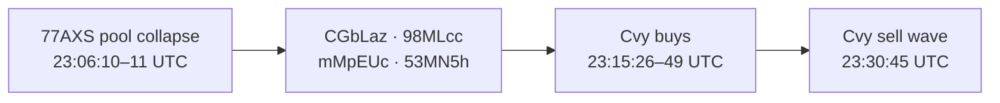
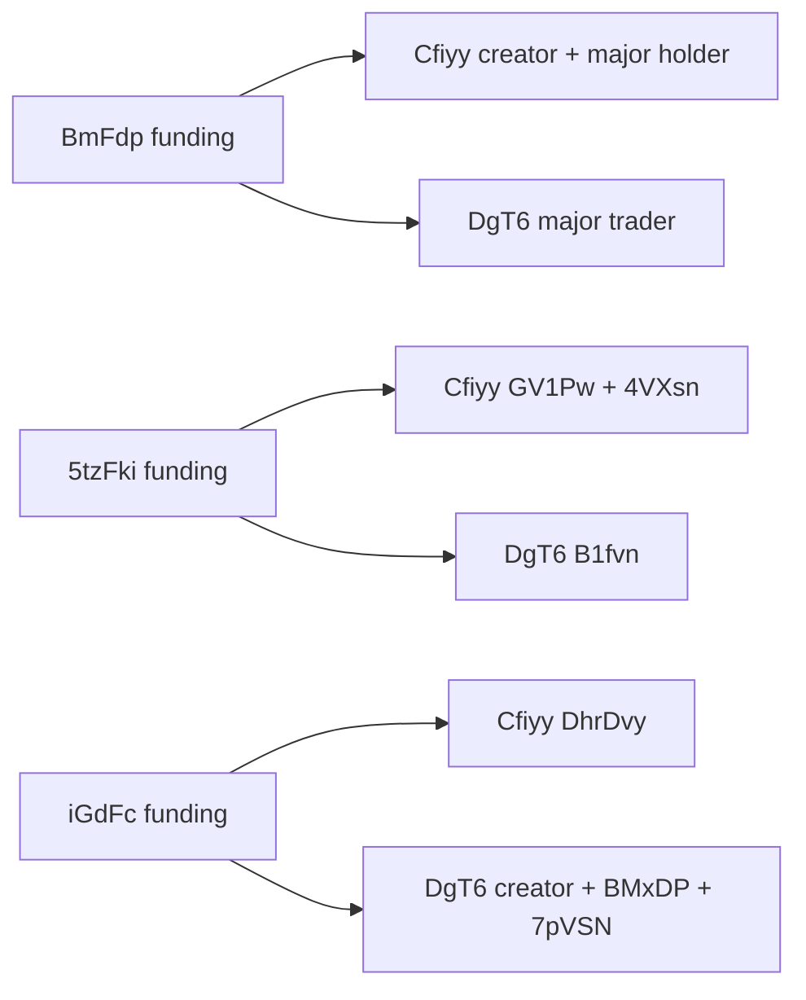

# Full-collapse coins and recurring wallet behavior

Investigation date: October11–12,2026 UTC. Primary example: `CvyUsq67bCiZZwr1dZKu2y1HXojjrz6tvdkKY4XGpump`. Second user example: Axiom pool `3g4Mfsjk19sh2ZqC9o7kL2gwV7yimzrAMa8P6pPMzNJQ`, resolved on chain to `Cfiyy91FAH88qNvVxLNDhdyiPJ2rYvZDT39GWciRpump`. Third user example: `DgT6hpeJzS3yW5UjcUvT4grfXogM1XvMwFKmrU4Vpump`. Fourth supplied address `Htgwb58PvcZ9qqRu7UcMEn9JdV9vzdTdDLHW9f3ockDW` is a bonding curve, resolved to mint `7xJKazFtFNEGUQB85KaFn5GDYGGFjUeNBTD8D1mQpump`. Fifth user example: `GKGnAwdnLjS9M3qeaxjALjeQnRCweWbTNK1FkbCepump`.

## Scope and definition

The user clarified the intended investigation: identify coins that collapse back toward the launch floor, then study their earlier behavior, wallets and funding. A full collapse is an **outcome label for forensic discovery**, not a requirement to wait for a collapse before recognizing a suspicious coin. The second example began as a user-labeled suspicious behavior/funding case; a later finalized refresh during this investigation also confirmed severe reserve depletion.

This investigation therefore uses deliberately selected examples and an outcome-selected candidate scan. It is not a backtest, estimate of detector accuracy, or profitability claim. No trading source, admission setting, runtime or order was changed. Bounded GPT-6 Luna max workers reviewed admission, wallet overlap and post-graduation transactions; root checked RPC funding and integrated the findings. GPT-6.1 Luna is unavailable in this runtime.

## Cvy: the reserve collapse is confirmed

The post-graduation pool is `EjzRfGWpvRSqmayWnHT3WkKp63jXAzZwhEUVNkwapwdr`. Its observed actual WSOL vault peaked at **90.773253401 SOL**. A finalized refresh at 23:45:39 UTC, context slot455837059, showed **1.294647602 SOL**, about **98.57% below** that peak. This is actual quote-vault depletion. The user's approximately $63k→$4k market-cap observation is recorded as user-reported; we did not reconstruct a historical SOL/USD series or substitute reserve percentages for USD market-cap returns.

The sharp local snapshot sequence at 23:30:45.557–46.138 UTC was **80.834257494 → 54.051788261 → 2.880820013 SOL**. The roughly581ms interval is the observer's snapshot-arrival clock, not millisecond-precise on-chain time. Confirmed transaction bodies independently authenticate the sell wave. Across incident slots455832951–455832959, all122 successful transactions were recovered: **120 PumpSwap sells by120 distinct seller owners/signers and two buys**. Thirteen failed signatures were retained separately and excluded from state changes.

The reconstructed incident balances run from82.722998428 to3.152594282 SOL. Sells paid80.059246844 SOL from the quote vault and brought707.787858 million tokens into the base vault; two buys contributed0.488842698 SOL and removed20.958594 million tokens. The changing reserves reconcile exactly. No LP-withdrawal transaction was found in this incident window; its collapse was an inventory sell wave.

These sellers largely came from the earlier launch population:115/120 have a curve-wallet record,99 held positive net curve tokens at completion, and43 sold an amount exactly equal to their net curve inventory. Several of the largest sellers were visible in our holder snapshot before S5 entry. This connects the collapse to previously retained supply rather than merely to anonymous last-minute addresses.

Five consecutive authenticated sells in slot455832954 alone take the vault from80.834257494 to54.051788261 SOL:

| Seller | Tokens sold, millions | WSOL vault decrease |
|---|---:|---:|
| `3E5C4bw4MmAXZK9f8D5PFqGJrxqauCUFtfvQ7jD6oha2` |7.747119|4.035819246 SOL|
| `mMpEUcCgvHmdXvkrawYszRZpXTVfp1E2rDCc4vtGfdw` |12.223194|5.733420584 SOL|
| `53MN5hAAGHu8Q8HM8ZCaenWYsBma4qTHD9Lp6ETKdLrL` |16.621623|6.760975204 SOL|
| `CGbLazQt5HXNPawzFct36WeFwj8dL4vGUd8KRHSJ1iCX` |17.711209|6.162394352 SOL|
| `98MLcc4UVzeLaDWckcBUCMcwS5CgSeqAjC4g2JNQ714c` |13.442042|4.089859847 SOL|

Signatures, vault deltas, order reconstruction and coverage are in [POST_GRADUATION.md](POST_GRADUATION.md) and its `amm_*` artifacts. RPC transaction ownership/balances follow the [official response structures](https://solana.com/docs/rpc/json-structures). Pool virtual quote reserves remain substantial even after actual WSOL depletion; an actual-vault balance and a virtual-reserve-adjusted price are separate measurements.

## Other collapse examples and repeat cohorts

We found a prior AMM coin, **`77AXSFnjgfgsT261R8wkPSwSe94BgheBS9hbLiQVpump`**, pool `Bt8gmEqPWojBQqVsF4BuBNYKwTCX7JQevWb81Cyof4Yk`. Authenticated sampled transactions show100.659488463 SOL in its quote vault at23:05:51 UTC and3.812404610 SOL at23:06:11 UTC, an observed decline of about96.21%. This is a bounded set of transaction witnesses, not a complete lifetime tape.

**CGbLaz,98MLcc,mMpEUc and53MN5h sold during that earlier23:06:10–11 wave, then bought Cvy and sold during its23:30:45 collapse.** Their Cvy buys happened23:15:26–49, before the bot's23:18:17 paper entry. The prior collapse and wallet history existed on chain before Cvy's entry, but our running detector had not assembled this history. Selecting the four wallets by looking back from Cvy is retrospective discovery; testing a prospective rule requires collecting the earlier collapse cohort first.



The separate curve-log scan covered a frozen600,237,762-byte prefix,104,155 unique signatures. It found84 **candidate** curve histories that reached at least10 SOL and later returned to at most1 SOL without observed curve completion. Returning to the launch floor is not the same as a literal zero token price. We did not classify all84 as manipulated or prove a common cause.

At a strict cutoff before Cvy's first event, three already-collapsed curve launches contained much of its eventual first20-buyer cohort:

| Prior mint | Observed peak → reserve before Cvy | Shared first20 Cvy buyers |
|---|---:|---:|
| `GWRjTLqFatZEgfLgN8AcLL3o3dtPgTqX7y71NBD9pump` |28.959→0.130 SOL|17/20|
| `mtSCzFPH2fED9NPh9DEh44uDPUjNUdG6y3se4Rcpump` |21.212→0.000000049 SOL|15/20|
| `F88iUaKH5dcaW9UdUZMQ6aqoCNi6DEV1kaQxwbBzpump` |18.679→0.0368 SOL|13/20|

This supports the user's observation that groups keep appearing on the same kinds of coins. The early repeat buyers and the later repeated dump sellers are different cohorts and should remain distinct. Independent snipers/copy traders can follow the same launches, so early co-buy overlap alone does not establish control. Full addresses, signatures, clipped-before-entry views and selection limits are in [WALLET_OVERLAP.md](WALLET_OVERLAP.md).

## Earlier trading and funding behavior

The Cvy curve capture contains1,615 unique successful receipts,1,783 trade events,392 users,892 buys and891 sells. Recorded gross buy/sell amounts total517.766986478/433.480016918 SOL. Of392 users,260 traded both directions;177 ended the captured curve window with exactly equal observed bought/sold token amounts. Those177 generated414.080715192 SOL of gross swap volume, about43.53% of captured gross volume.

Inventory-zero-to-zero cycles were common:328 completed observed cycles, including25 lasting at most five integer-timestamp seconds. These are successful on-chain swaps. We have not established what proportion is self-dealing, and transfer coverage is incomplete; the counts are turnover evidence rather than a declaration that all951 SOL was fake.

Two pairs behave almost identically throughout the target capture:

- `B9ksmPhuhj43BBWXJxm1SUXDbVZRthmvf8FZMpYhVhoH` and `CMcKT7wshBUjRrPy6uH4bdTRkmxFLngQh2kTXrrzRVdC`: all24 actions match direction within one second, median provider-arrival gap2ms.
- `Hy4ZuryDVXuytB3TGXmAdcqHQeF7WMQD4dZLdAipyVFt` and `7dGV2auDmovmUbb27KBW1QNN52aLXd4ZZbafG9nyr5VT`: all18 actions match, median gap1ms.

They also traded the three prior curve-collapse candidates. Arrival synchrony is a useful automation witness, not proof of shared keys. Four fee payers sponsor multiple Cvy users, including one with42 users; shared relayers must be distinguished from controlling wallets. Generic transaction fingerprints are especially weak: one matching route fingerprint occurs across308 observed mints and1,804 buyers.

The bounded funding probe resolved191 transaction bodies for19 selected wallets. Six high-volume Cvy participants received meaningful funding through six distinct intermediate wallets at23:06:35–36, roughly seven minutes before launch. Ancestry queries show synchronized multi-hop lanes, including zero-space System `createAccount` instructions and full-balance forwarding less5,450lamport steps. We authenticated three upstream links per lane, and the next sampled origins had received their money only another second earlier. A common ultimate root has not been established. These parallel relay chains deserve study alongside persistent exact-wallet cohorts; different immediate funders do not establish independence. Artifacts: `rpc_funding_*`, `rpc_rotation_*`.

Tiny transfer records also appear throughout the funding history. Some1,000-lamport senders resemble the prefix/suffix of earlier substantial funders. That is consistent with address-poisoning activity and should not be treated as ownership evidence without further verification. Meaningful funding, tiny unsolicited transfers, creation funding and relay lineage must remain distinguishable.

## Second example: Cfiyy / Axiom 3g4Mfs

The supplied Axiom address is a PumpSwap pool. The resolved mint is **`Cfiyy91FAH88qNvVxLNDhdyiPJ2rYvZDT39GWciRpump`**, coin creator `Ams5SkLrpW6s8wpDbbaTm5k5MViWdhBZsmu3XA9rTLe1`. It is a separate behavior/funding example, not a proven second instance of the same operator.

At its entry-time holder snapshot, the top four wallets held **48.10%** of actual supply. Two, `GV1PwVV8rQVbCagDkUZMgiFCXUwE4wdYV3prKNNtkkzw` and `4VXsnEr667i7pnQZaxexqGndNvAK3NmL76ZCCo7mmEqU`, held13.3521% and6.9208%, totaling **20.2728%**. Both received verified direct transfers from `5tzFkiKscXHK5ZXCGbXZxdw7gTjjD1mBwuoFbhUvuAi9` at21:56:06 UTC,99m14s before launch. Another source, `BmFdpraQhkiDQE6SnfG5omcA1VwzqfXrwtNYBwWTymy6`, funded both the creator and the largest holder `3rroAWY61vHQAbvTEHfTtLbw5azfTiCMpAVgaKTUayG8`. Source degree/full ownership history is unverified; the association is real, the control inference remains open.

The second capture has385 curve receipts and234 external users. Only four users overlap Cvy; two arrived before the second paper entry, two afterward. Thus there is no evidence yet that both coins share a broad exact-address buyer group. Its initial frozen86 AMM snapshots show raw quote reserve peaking78.579908270 SOL, bottoming30.503515506 and ending43.047953056 at23:41:13 UTC. That initial window did not meet the full-collapse label. **A later finalized RPC refresh at23:51:11 UTC, slot455838579, directly verifies4.562989223 SOL in its WSOL vault**, about94.19% below the observed peak. Both vaults identify the supplied pool as owner and the base vault identifies the resolved mint. The base vault then holds797.169715 million tokens out of853.533134 million actual supply. This changes the outcome evidence from pending to severe reserve depletion; it does not establish common operators across the two examples. The selected funding sample resolved84 transaction bodies for nine wallets. See [SECOND_COIN.md](SECOND_COIN.md), `second_MANIFEST.json`, `second_rpc_current_vaults.json` and `second_rpc_*`.

## Third example and a shared funding family

The third mint is `DgT6hpeJzS3yW5UjcUvT4grfXogM1XvMwFKmrU4Vpump`, creator `Fabbi4uTLHQSRHsc3t5UAFhZVuwmmsUj1hcN9nD5dK3J`, pool `7LAx8jrRB5zXgeH69RXs2FwXjmoXzTUXwfUU1fPrHbpc`. The initial frozen capture has308 successful curve receipts,200 users,12 holder screens and124 AMM snapshots. It shows a substantial rapid extraction: sampled actual quote reserve peaks79.484SOL and falls to30.464SOL. The recovered incident bodies contain47 sells from45 seller owners and eight buys, with net vault outflow26.066889SOL. A finalized read at23:57:33 still shows30.931SOL. This case has a severe sell shock, not an observed near-zero reserve state at that cutoff. One sharp-break transaction and one later body remain unresolved; no Withdraw instruction was found among117 recovered bodies. A literal sub0.5s execution duration needs finer timing than sparse snapshots and one-second RPC block times; a761ms observer-snapshot interval does not exclude a faster sell sequence between samples. Detailed attribution and clock limits are in [THIRD_COIN.md](THIRD_COIN.md); pre-collapse sequencing is in [THIRD_BEHAVIOR.md](THIRD_BEHAVIOR.md).

The strongest new finding is **shared funding across the second and third examples**, even when their major trading wallets differ. Seven selected third wallets' bounded histories yielded48 resolved transaction bodies. Combining them with the second case verifies these edges:

The DgT6 pool's bounded2,000-signature sample contains1,881 failed transactions and119 successful transactions. This sample begins after opening and covers23:55:17–23:57:24UTC; it is not a lifetime attempt rate. Failed transactions touching a pool are attempted activity, and must remain separate from successful swap volume and state changes. They are a useful automation/traffic observation with benign arbitrage/slippage competition as a possible explanation, rather than a stand-alone fraud test.

| Funding source | Cfiyy recipients | DgT6 recipients |
|---|---|---|
| `BmFdpraQhkiDQE6SnfG5omcA1VwzqfXrwtNYBwWTymy6` | Creator `Ams5Sk...`; largest holder `3rroAW...` | Major trader `BbiQH6...` |
| `5tzFkiKscXHK5ZXCGbXZxdw7gTjjD1mBwuoFbhUvuAi9` | `GV1Pw...`; `4VXsn...` | `B1fvn...` |
| `iGdFcQoyR2MwbXMHQskhmNsqddZ6rinsipHc4TNSdwu` | `DhrDvy...` | Creator `Fabbi4...`; holders `BMxDP...` and `7pVSN...` |

The same successful transaction **`5a7sB5KdCisUxSyDevDF7XVseqGAqiQZ3mjEybkgC76G7HuYFzngjnkcm74NnbNEn9C6EHghN91iofmFpEWoDznv`** sent0.065732SOL to both Cfiyy's `GV1Pw...` and DgT6's `B1fvn...` at21:56:06UTC. The `BmFdp...` seeds to `3rroAW...` and `BbiQH6...` are both exactly0.057667SOL. The `iGdFc...` funding of Cfiyy's `DhrDvy...` and DgT6's `7pVSN...` occurs at21:58:21UTC. These timestamps are before both launches, well outside a five-minute launch-funding window.

The token-flow match is stronger still. **Four early wallets acquire and forward exactly the same four token amounts to four receiving wallets across both launches**:352.243820712452million,182.270662645082million,106.467965872131million and69.207549760218million. These sum to710.189998989883million tokens, about71.019% of one-billion-token launch supply. All eight wallet-to-wallet relays have successful parsed transfer instructions, verified recipient owners and an exact earlier-buy match. The receiving wallets then begin their observed swap activity by selling. This is a repeated early acquisition → inventory relay → seller-wallet template; [TRANSFER_REVIEW.md](TRANSFER_REVIEW.md) records the full proof and distinguishes protocol-vault swap transfers. Gross early acquisition is separate from currently retained supply.



The source-associated holders and creators are a more specific forensic lead than a common trading-route fingerprint. Source services/common beneficial ownership remain to be distinguished. All edges are backed by parsed successful System Program instructions in `second_rpc_incoming_transfers.json`, `third_rpc_incoming_transfers.json` and their raw bodies. Narrow complete-window source degree is not inferred from the selected destinations.

## Fourth supplied address: Htgwb / 7xJK

`Htgwb58PvcZ9qqRu7UcMEn9JdV9vzdTdDLHW9f3ockDW` is owned by the Pump program and is a bonding-curve account. A finalized transaction's token balances identify its held mint as **`7xJKazFtFNEGUQB85KaFn5GDYGGFjUeNBTD8D1mQpump`** (`fourth_identity.json`). Searching by the supplied curve address would miss mint-indexed receipt records, so it was resolved before analysis.

The frozen mint-specific capture has1,223 curve receipts,315 users,38 holder-screen rows and15 verdict rows. Observed real curve reserve reaches **77.448648741SOL**, then ends at **0.214681618SOL** byOctober12 00:00:47UTC (exact trajectory timestamps in [FOURTH_COIN.md](FOURTH_COIN.md)). No AMM evidence exists in this frozen package; curve completion must be checked from the actual real-token reserve, rather than interpreting absent pool coverage as liquidation.

At its S5 paper entry the largest current holders include **CGbLaz,98MLcc,mMpEUc and3E5C4bw**, all present in Cvy's rapid AMM sell wave. The prior77AXS collapse and Cvy's sell wave happened before this mint's23:50:00UTC creation receipt. This supplies a third launch with the same repeatedly exposed inventory cohort, and a concrete historical relationship that could have existed before the new entry if persisted/collected. The recorded Watch screen at23:54:50.940 reports zero launch-window funding links, an incomplete256-item receipt ring and zero cross-launch records. The paper entry at23:55:00 is unwhitelisted. Current direct-funding recency is therefore missing a relevant already-existing history.

This case connects more closely to Cvy's recurring holder/seller cohort, while Cfiyy and DgT6 share the identical early allocation/relay and funding-family structure. Both mechanisms deserve separate analysis; the examples need not have the same ultimate operator. [FOURTH_COIN.md](FOURTH_COIN.md) records the precise collapse and actor comparison; root RPC witness bodies and funding are in `fourth_rpc_*`.

There is also an exact seed-and-sale recipe across Cvy and7xJK. Cvy's `Dv4MuKsqjXZPMsep9ZDdXrRvNmCEFFGPoYidRMgJQsad` and7xJK's `CmxVhnMu3VSjK7aCLoVi31m5jRMHpgrQkNWDmjHGpQbf` each make one buy of **15.799270901SOL**, acquiring exactly **360,271,445,579,211 raw tokens** (360.271445579211million, about36.027% of launch supply), then sell the whole observed position in67 and74 pieces respectively. Token and quoted SOL amounts match exactly across the two launches, while addresses differ. Root's fourth RPC witness capture resolves21/21 requested bodies, including this first-buy receipt, creator funding and16 largest captured sell signatures. The new creator and large buyer were funded at23:31:10–11, just after Cvy's collapse, through distinct sources; a common money origin is not established. This is a repeatable template to study with the recurring later holder/seller cohort, not a stand-alone rule to block every16SOL seed buy.

The adjacent Cfiyy andDgT6 launches also have a broader exact-wallet repeat than their major relays: **112/152 noncreator wallets observed before DgT6's S5 source transaction had already appeared in Cfiyy**, all with receipt gaps beyond the ten-minute detector history. The completed DgT6 tape overlaps143/199 external wallets with Cfiyy. These are observed address sets, not independent-person counts. [THIRD_BEHAVIOR.md](THIRD_BEHAVIOR.md) separates the entry-time and later intersections and shows one unreconciled19.05million-token balance residual, preventing the initial four transfer matches from being treated as a complete custody ledger.

Identical quoted SOL and token outputs can be mechanically caused by identical input budgets and initial curve states. Treat each repeated seed recipe as one operational-template observation; do not count its deterministic token output as independent corroboration. Funded creator/holder links, authenticated custody transfers, prior-collapse participation and later liquidation history supply additional evidence. Automated templates alone do not attribute all volume to self-dealing.

## Fifth example: GKGn

GKGn's214 successful curve receipts show real reserve **34.125787887→0.015066200SOL**, without an observed zero real-token reserve or graduation. The creator's early sell disposes of its entire observed265.758514million-token initial purchase, taking reserve10.504874371→0.354245635SOL. The later post-peak burst contains31 distinct seller wallets within one integer-timestamp second across two slots and empties34.1258SOL to0.0374SOL. [FIFTH_COIN.md](FIFTH_COIN.md) separates those episodes and shows no overlap with the other cases among17 pre-entry noncreator addresses.

This coin entered **S1**, unlike the four S5 examples, using a fresh Watch screen with nine resolved holders, incomplete funding/cross-launch coverage and no retained-cluster score. The absence of an early exact-address match does not mean its funding is independent: root's bounded35/35-resolved-transaction follow-up verifies **`BmFdp...` funded this creator too** with0.986701SOL at23:48:33UTC. That source also funds creator/holder wallets in Cfiyy/DgT6. A separate source, `7XPhGwKLGd3SxTQjSJddbwj7Xitomdiz9vpYtDG33iYH`, funds GKGn's `FqMEg...`,`Dd2rj...` and`7dc8h...` with2.381423096/2.410219168/2.278267699SOL at23:47:28–29UTC. This is a meaningful shared-funding group about22minutes before launch; source degree/control are unverified. Two of those later major traders do not yet appear at the S1 entry, so their later involvement cannot be smuggled into that decision. Tiny1lamport transfers are preserved separately as weak unsolicited associations.

GKGn therefore has a funding-family connection to the earlier examples, but its visible early trader sequence is a creator dump/recovery rather than the same four-position relay. The investigation does not establish artificial-volume attribution across all five. Source bodies and selections are in `fifth_rpc_*`; the common-pattern proposal is in [WATCHER_MAPPING.md](WATCHER_MAPPING.md).

## What we learned about the detector

All five user examples were admitted as **Watch** into the paper ledger: fourS5 and oneS1, without a whitelist exception. None of those entries has a confirmed bot transaction signature. Watch allows partial evidence; it is not an organic-coin certificate.

The current block rule requires a verified narrow direct launch funder, at least three linked holders, at least20% retained supply and corroboration. Cvy's entry screen probed8 of19 resolved holder wallets, retained256 receipt items with incomplete coverage and no complete cross-launch history. It missed the previous collapse/seller history and could not link the multi-hop funding lanes. Cfiyy's funding sample was also incomplete; its verified two-wallet funding pair falls below three wallets and its older funding falls far outside the five-minute launch window.

The present rule primarily detects a particular form of linked retained ownership. The examples motivate studying **persistent prior-collapse seller cohorts, rotating multi-hop funding, early inventory-transfer templates, repeated trade/inventory sequences and synchronized inventory liquidation**, in addition to retained supply. The current buyer identity and current token holder can be different wallets linked by an authenticated transfer. A wash-volume group need not retain20% at the current instant. Historical funding facts should remain stored even when they age out of a current verdict; current balances need separate freshness checks. A separate50-signature-per-source sample observes28/53/34 outgoing recipients for the three common funders in later sampled windows (`shared_funder_summary.json`); those are partial-history degrees, not complete launch-window classifications. Broad funding activity requires service/factory provenance rather than automatic benign or malicious labeling.

## Next research, using these examples correctly

Keep a forensic casebook with confirmed collapse outcomes and separate suspicious/pending behavior labels, preserving the time a pending label becomes confirmed. For each collapse, reconstruct pre-collapse buyer, retained-inventory, funding/rotation and liquidation cohorts. Then compare those features with active coins that did not collapse over the same observed horizon, with incomplete history marked unknown. Split creator-associated holders, persistent dump sellers, generic repeat buyers and service fee payers rather than treating all overlap as one entity.

Freeze one candidate evidence rule after that comparison, then measure false blocks/misses on later untouched examples. Use only historical information available at the new coin's decision time. Do not bake this coin's later dump or an eventual seller list into an earlier live decision. No new thresholds or automatic wallet blacklist was introduced here.

## Investigation card

```text
mode: read-only forensic case study; no backtest, profitability claim or deployment
selection: user-selected Cvy, Cfiyy, DgT6, Htgwb/7xJK andGKGn examples; retrospective collapse-selected scan and targeted wallet histories
sources: frozen receipt/holder/verdict/intent logs, finalized/confirmed Solana RPC transactions and vault balances; source/time/coverage manifests retained
primary outcome: Cvy confirmed inventory-driven reserve collapse; prior77AXS confirmed sampled reserve collapse; three prior curve-floor candidates with repeated early buyers
second outcome: Cfiyy initially pending at23:41:13; finalized23:51:11 vault confirms94.19% observed peak-to-current reserve depletion
third case: DgT6 rapid extraction; shared creator/holder funding with Cfiyy; detailed sell/clock/coverage findings in THIRD_COIN.md
fourth case: Htgwb is a curve account for7xJK; observed77.4486→0.2147SOL, with repeated Cvy holder/seller addresses
fifth case: GKGn34.1258→0.0151SOL; S1Watch entry, creator-dump and later31sellerburst, shared creator-funder association but different pre-entry address set
causality: distinguish event-time history, actual detector-collected evidence and later targeted discovery
limits: no common-owner proof, no all-volume wash attribution, sparse prior77AXS tape, bounded funding ancestry, short observation universe, no population false-positive calibration
changes: reports/data evidence and living setup context only; no source/config/runtime/order changes
verdict: exploratory evidence supports recurring cohorts and severe sell-wave outcomes; detector accuracy/profitability not established
```
