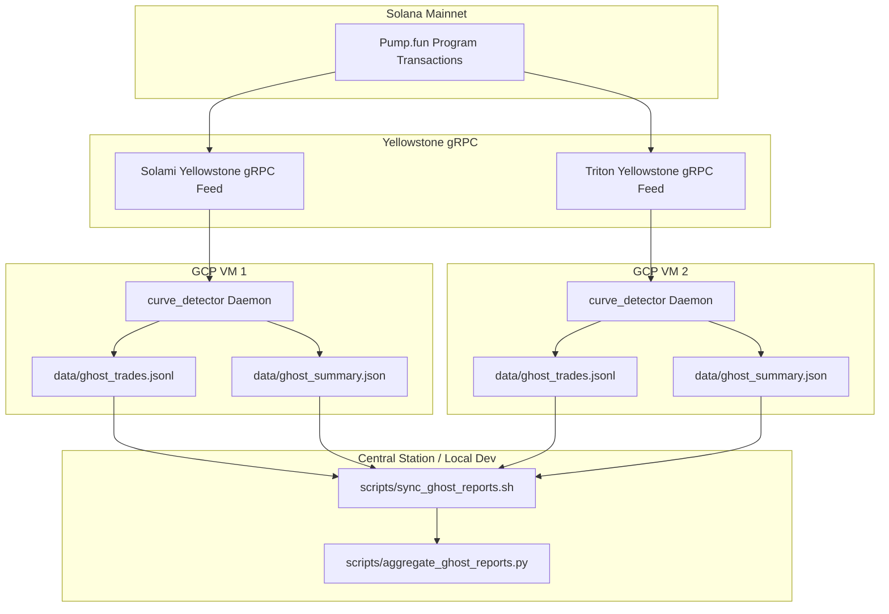

# Solana Starting 5 — Master Ghost Forward Validation Plan (Phase 1)

**Document Date:** October 8, 2026  
**Status:** ACTIVE SPECIFICATION & DEPLOYMENT RUNBOOK  
**Engine Binary:** [`src/bin/curve_detector.rs`](file:///home/mthwt/code/Crypto/src/bin/curve_detector.rs)  
**Strategy Library:** [`src/bot/curve_detector.rs`](file:///home/mthwt/code/Crypto/src/bot/curve_detector.rs)  
**Single Source of Truth:** [`research/MASTER_STRATEGY_REGISTRY.md`](file:///home/mthwt/code/Crypto/research/MASTER_STRATEGY_REGISTRY.md)  
**Calibration References:** [`research/BACKTEST_ACCURACY_CONTRACT.md`](file:///home/mthwt/code/Crypto/research/BACKTEST_ACCURACY_CONTRACT.md) & [`research/BUY_VS_SELL_STRATEGY_DIAGNOSTIC_REPORT.md`](file:///home/mthwt/code/Crypto/research/BUY_VS_SELL_STRATEGY_DIAGNOSTIC_REPORT.md)

---

## 1. Executive Summary & Objective

The **Ghost Forward Validation Plan** establishes a zero-capital live forward testing environment on Solana mainnet. It streams live on-chain bonding curve events directly from Yellowstone gRPC, detects entry signals across the Canonical Starting 5 strategies in real-time, simulates accurate execution fills with latency modeling, and evaluates tailored exits tick-by-tick.

### Core Objectives:
1. **Zero Real Capital Risk:** Exactly **0.00 SOL** live capital is risked during Phase 1.
2. **Elimination of Retrospective Bias:** Historical backtests suffer from lookahead artifacts, censorship gaps, and curve tape discrepancies. Live forward streaming tests against unmanipulated future data.
3. **Execution Latency & Fill Realism:** Benchmark against the Central85 placement scenario (15.0 SOL bankroll, 0.50 SOL tickets, max 2 concurrent positions).
4. **Multi-VM Diversity:** Run identical or staggered detection logic across 2 GCP VM instances to monitor network jitter, geographic variance, and gRPC delivery latency.

---

## 2. Infrastructure & Ingress Architecture



### Ingress Guardrails:
- **Standard Yellowstone gRPC:** Filter directly on `PUMP_PROGRAM_ID` (`6EF8rrecthR5Dkzon8Nwu78hRvfCKubJ14M5uBEwF6P`) with `vote: false` and `failed: false`.
- **CRITICAL COST RULE:** Do **NOT** use Triton Deshred PAYG for paper validation. A full Pump.fun transaction stream burns tens of millions of transaction events daily, which would rapidly deplete pay-as-you-go credits. Use Yellowstone gRPC via Solami (`sk_7hPGeJuMS_ASwhlvlxKBn_6N5hm8I4bKSP8xyaRFSXI`) or unlimited flat-rate RPC endpoints.

---

## 3. Canonical Strategy Matrix (S1–S5)

All triggers, filters, and exit rules strictly benchmark against [`research/MASTER_STRATEGY_REGISTRY.md`](file:///home/mthwt/code/Crypto/research/MASTER_STRATEGY_REGISTRY.md) and empirical diagnostic refinements:

| Strat | Name | Causal Entry Trigger | Tailored Exit Architecture | Circuit Breaker |
|---|---|---|---|---|
| **S1** | Dev Dump Absorption | Creator held >0, sold $\ge 95\%$; reserve 1.0–5.0 SOL; $\ge 2$ outside buyers. | Invalidation stop at net $\le -10\%$ / trough breach; 40% sold at $+25\%$; remaining 60% trails on 15pp giveback. | Streak 5, loss ceiling 0.60 SOL, window 6h, cooldown 3h. |
| **S2** | Survival Shelf Breakout | Cross 10.8–14.0 SOL from below; dev held $\le 15\%$; **age $\le 240$s**; **outside buyers 25–80**. | Invalidation at $\le 9.8$ SOL; $+10\%$ arms breakeven; 40% sold at $+30\%$; remaining 60% trails on 15pp giveback. | Streak 8, loss ceiling 0.60 SOL, window 8h, cooldown 4h. |
| **S3** | Whale Dislocation Floor | Reserve 8.0–18.0 SOL; whale sell $\ge 1.5$ SOL absorbed by $\ge 2$ outside buyers ($\ge 0.25$ SOL). | **8s breathing grace** before $-12\%$ stop; $+75\%$ arms 20pp trail; 60s flat timeout. | Streak 10, loss ceiling 0.50 SOL, window 4h, cooldown 2h. |
| **S4** | Upper ATH Breakout | Reserve 16.0–22.0 SOL; new ATH; $\ge 22$ outside buyers; outside buy $\ge 1.0$ SOL. | **4s rejection grace** before $-8\%$ stop; 50% sold at $+20\%$; remaining 50% trails with 6% relative giveback. | Streak 6, loss ceiling 0.75 SOL, window 8h, cooldown 4h. |
| **S5** | Pre-Graduation Carryover | Reserve $\ge 72.0$ SOL; $\ge 100$ outside buyers; approaching 84 SOL graduation. | Invalidation at $\le 60.0$ SOL; 50% sold at 84 SOL graduation; remaining 50% trails with 8% relative trail; 30s timeout post-grad. | Streak 5, loss ceiling 0.80 SOL, window 12h, cooldown 6h. |

---

## 4. Multi-VM Operational Setup

### VM Configuration:
- **VM 1:** Primary detector (GCP region: `us-central1-a`).
  - Ingress: Solami Yellowstone gRPC (`https://grpc.solami.dev`).
  - Ident: `VM_ID=gcp-us-central1`.
- **VM 2:** Redundant verification detector (GCP region: `us-east1-b` or `europe-west3-a`).
  - Ingress: Secondary gRPC endpoint.
  - Ident: `VM_ID=gcp-secondary`.

### Running on VM:
```bash
# Set environment variables
export VM_ID="gcp-us-central1"
export PAPER_BANKROLL_SOL="15.0"
export MAX_POSITIONS="2"
export SOLAMI_GRPC_URL="https://grpc.solami.dev"
export SOLAMI_API_KEY="sk_7hPGeJuMS_ASwhlvlxKBn_6N5hm8I4bKSP8xyaRFSXI"

# Launch detector in background
nohup cargo run --release --bin curve_detector > logs/curve_detector.log 2>&1 &
```

### Telemetry Sync & Aggregator:
From the local development workspace:
```bash
# 1. Sync remote VM logs
export VM1_HOST="mthwt@<vm1-ip>"
export VM2_HOST="mthwt@<vm2-ip>"
bash scripts/sync_ghost_reports.sh

# 2. View live aggregate performance dashboard
python3 scripts/aggregate_ghost_reports.py

# 3. Live watch mode (refreshes every 10s)
python3 scripts/aggregate_ghost_reports.py --watch 10
```

---

## 5. Promotion Gates: Ghost Paper to Live Capital

Live capital deployment (even a small 1.0–2.0 SOL micro-probe) is strictly blocked until the paper forward runner meets all six gates:

| # | Gate Metric | Required Threshold | Rationale |
|---|---|---|---|
| **G1** | Sample Size | $\ge 150$ closed paper trades | Guarantees statistical significance across varying market conditions. |
| **G2** | Forward Duration | $\ge 7$ consecutive calendar days | Proves continuous daemon stability and resilience across weekend/weekday cycles. |
| **G3** | Settled Net PnL | $> +1.50$ SOL net ($> +10\%$ bankroll return) | Positive settled capital under Central85 placement and full fee accounting. |
| **G4** | Profit Factor | $\ge 1.35$ | Verifies gross wins meaningfully exceed gross losses. |
| **G5** | Strategy Drawdown | No strategy with net loss $< -1.0$ SOL | Confirms circuit breakers successfully limit downside cascades. |
| **G6** | Geographic Parity | VM1 vs VM2 PnL delta $< 25\%$ | Validates signals are not hyper-sensitive to localized network jitter. |

---

## 6. Audit & File Inventory

- Runner binary: [`src/bin/curve_detector.rs`](file:///home/mthwt/code/Crypto/src/bin/curve_detector.rs)
- Signal & exit library: [`src/bot/curve_detector.rs`](file:///home/mthwt/code/Crypto/src/bot/curve_detector.rs)
- Sync tool: [`scripts/sync_ghost_reports.sh`](file:///home/mthwt/code/Crypto/scripts/sync_ghost_reports.sh)
- Telemetry dashboard: [`scripts/aggregate_ghost_reports.py`](file:///home/mthwt/code/Crypto/scripts/aggregate_ghost_reports.py)
- Canonical backtest engine: [`scripts/run_canonical_backtest.py`](file:///home/mthwt/code/Crypto/scripts/run_canonical_backtest.py)
