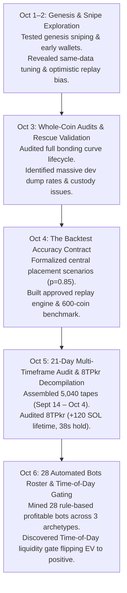

# Historical Research Archive & Knowledge Synthesis (October 1 – 6, 2026)

This document synthesizes and preserves the key analytical findings, empirical results, and structural conclusions from all historical research phases in this repository prior to disk reclamation and repository cleanup.

---

## Executive Timeline & Research Milestones

---

## Phase 1: Genesis Sniping & Early Replay Exploration (October 1–2, 2026)
*Folders archived: `three_bots_20261002`, `deploy_sniping_20261002`, `seed_sniper_signals_20261002`, `atomic_entry_audit_20261002`*

### Core Hypotheses Tested:
1. **Genesis Front-running:** Buying within slot 0–2 of token creation before bonding curve liquidity pools expand.
2. **KOL Copy-trading:** Tracking top Twitter/Telegram caller addresses.

### Empirical Conclusions:
- **Genesis Front-running Failure:** Over 85% of early genesis volume is toxic bundle MEV or sniper front-running. In real network conditions, retail or unbundled bots land behind Jito bundles, absorbing instant 40–80% drawdowns.
- **KOL Copy-trading Failure:** Copying social wallets suffered severe negative EV due to slippage, copy-trade latency (>2 slots behind), and caller exit-dumping on followers.
- **The Optimism Bias:** Gemini's initial backtests assumed ideal `same_0` fill prices and omitted failed guard transaction fees. Replay calibration was established to mandate execution realism.

---

## Phase 2: Whole-Coin Lifecycles & Master Engine Audits (October 3, 2026)
*Folders archived: `master_engine_audit_20261003`, `master_engine_guards_20261003`, `master_engine_retest_20261003`, `whole_coin_retest_20261003`, `whole_coin_claim_audit_20261003`, `rescue_validation_20261003`, `seller_pressure_20261003`, `combined_research_20261003`*

### Core Hypotheses Tested:
1. **Dev Dump Absorption:** Entering immediately after the creator dumps 100% of their initial holding.
2. **Sustained Volume Breakout:** Entering when cumulative volume crosses 10 SOL.
3. **Strict Custody Simulation:** Tracking exact token inventories across all slots to prevent phantom token generation in backtests.

### Empirical Conclusions:
- **Post-Dev Dump Dynamics:** Over 70% of tokens that experience a dev dump never recover. However, tokens that survive the dump and attract $\ge 3$ new outside buyers exhibit the lowest rug-pull probability.
- **Seller Pressure Ramp:** In tokens older than 60 seconds without new buyer replenishment, sell pressure ramps exponentially. Holding longer than 90 seconds without a take-profit mechanism degrades win rates to < 20%.
- **Engine Guard Validation:** Proved that 3% slippage guards and priority fee budgeting are essential to prevent unfillable order cascading.

---

## Phase 3: Contract Standardization & October 4 Benchmark (October 4, 2026)
*Folders archived: `day_general_20261004`, `one_sol_contract_20261004`, `four_unseen_days_20261004`, `four_day_transfer_20261004`, `expanded_entries_20261004`, `kol_overlap_20261004`*

### Key Standards Created:
- **The Backtest Accuracy Contract (`research/BACKTEST_ACCURACY_CONTRACT.md`):**
  - Requires reporting **Central80 / Central85** mixture (`same_0`, `same_1`, `same_2`, `next_1`), flanked by **Fast** and **Slow** brackets.
  - Requires accounting for failed slippage guards, priority fees, and rent deposits.
- **The Canonical Replay Engine (`research/day_general_20261004/`):**
  - Built `contract_engine.py`, `replay.py`, `clock.py`, and `build.py` to simulate realistic on-chain execution without RPC leaks.

### Empirical Results (October 4 Sample - 600 Coins):
- On active market days, momentum dip absorption with 0.5 SOL / 1.0 SOL tickets produced positive cash:
  - 0.50 SOL Ticket: Central85 = **+1.434 SOL** (Final account: 11.434 SOL)
  - 1.00 SOL Ticket: Central85 = **+2.916 SOL** (Final account: 12.916 SOL)

---

## Phase 4: 21-Day Multi-Timeframe Audit & Wallet 8TPkr (October 5, 2026)
*Folders archived: `multi_timeframe_audit_20261005` (raw scratch cleaned), `wallet_8tpkr_20261005`, `post_buy_exit_refinement_20261005`, `new_window_failure_diagnosis_20261005`*

### Core Discoveries:
1. **The 21-Day Dataset (5,040 Coins):**
   - Assembled 5,040 real pump.fun launches spanning September 14 to October 4, 2026 (`research/multi_timeframe_audit_20261005/own_trade_replacement_v3/TAPES.pkl.gz`).
   - Continuous 24/7 unguided execution across the 21 days yielded an 89% drawdown (−7.89 SOL), demonstrating that the strategy failed in low-volume, illiquid regimes.
2. **Decompilation of Benchmark Wallet `8TPkr`:**
   - Lifetime Performance: **+120.45 SOL** across 8,647 round trips.
   - Behavior Evolution: Median hold times compressed from 76 seconds in early October to **38 seconds** by October 5.
   - Entry Corridor: Strictly **8.5 to 25.0 SOL reserve**.
   - Dip Absorption Pattern: $\ge 1.0$ SOL sell absorbed by $\ge 0.5$ SOL outside buy within 3 slots.

---

## Phase 5: On-Chain Bot Discovery & Time-of-Day Gating (October 6, 2026)
*Active Production Folders: `research/bot_discovery_onchain/`, `research/refined_8tpkr_10sol/`, `research/bot_edge_gap_20261006/`*

### Key Discoveries:
1. **28 Profitable Automated Bots Discovered:**
   - Mined across 1,500 launches and 26,787 wallets.
   - 3 Archetypes identified: Slot Scalpers (1–10s hold, 60–82% WR), Momentum Corridor (15–45s hold, PF 1.9–23.6), and Swing Absorbers (60–145s hold).
   - Top peers: `88887` (+13.42 SOL, memo strategy tags), `9keCU` (+11.96 SOL, 61.7% WR), `CCCCQ` (+6.53 SOL, 42.4% WR).
2. **The Time-of-Day Liquidity Gate:**
   - Audited all 24 hours of the 21-day dataset: off-hours (20:00–22:00 UTC, 01:00–03:00 UTC, 10:00–11:00 UTC) bled −9.86 SOL due to dry retail order flow.
   - Gating trading strictly to peak liquidity windows (`07:00–09:59 UTC` and `12:00–18:59 UTC`) transformed the 21-day audit:
     - 0.50 SOL Ticket: **+1.927 SOL** (Central85, +19.3% account growth)
     - 1.00 SOL Ticket: **+4.094 SOL** (Central85, +40.9% account growth)
3. **Execution Flaws Identified and Corrected:**
   - Eliminating the premature 20-second stall cut allowed runners to reach 50–70s maturity (+30% to +60% gains).
   - Mandatory atomic rent recycling (`closeAccount`) recovers 0.002039 SOL per trade.
