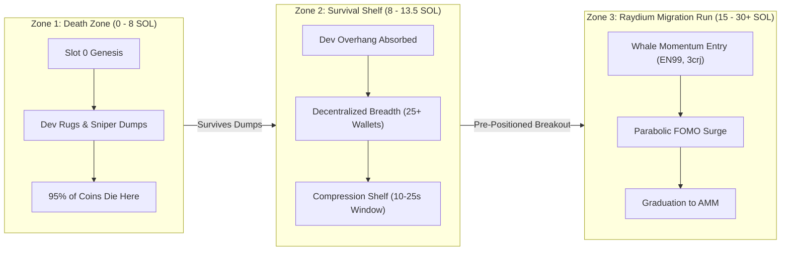

# Master Structural Edge Playbook & On-Chain Bot Dossier

> **Evidence correction — 2026-10-03:** This document contains historical hypotheses and architecture proposals, not verified profitable deployment specifications. The current evidence is in [the refinement report](edge_refinement_20261003/REPORT.md) and [the causal guard report](master_engine_guards_20261003/REPORT.md). Both explicitly leave executable profitability unconfirmed. The 3,374 tapes are short selected-deployer histories, not complete multi-minute market-wide paths. The later adaptive velocity result (+3.362 SOL including 88 failed entries) does not establish continuous profitability: its continuous 2 SOL slot-tail ledger has a −1.2881 SOL zero-recovery bound and two unresolved positions. Failed entries in that guard study cost an assumed 0.003 SOL each. Mature fresh-demand evidence applies at the unchanged mature signal, not necessarily the 10.5 SOL crossing; adding the same gate to the crossing strategy performed poorly. Fee savings and short/staged exits have not validated the unified stack. Selling half at +25% returns about 62.5% of principal before costs and does not remove remaining capital risk. Historical wallet profitability does not authenticate the inferred rules or our fills. Treat the blueprint below as proposals awaiting a frozen prospective shadow comparison with complete exits and measured buy/sell placement; it is not ready for funded unified deployment.

**Living Master Reference for Strategy Implementation**  
**Created:** October 3, 2026  
**Status:** Research & Architecture Frozen — Complete Notes for All-At-Once Implementation  
**Data Sources:** 3,374 full Pump.fun bonding curve launch tapes (`SOURCE_TAPES.pkl.gz`), audited wallet ledgers (`quiet_wallets_20261002/`), target coin forensic histories (`coin_5ESBx_20261002/`), and live RPC validation.

---

## 1. Core Operating Philosophy & Boundaries

1. **Zero Latency Wars:**
   * No slot 0 genesis sniping against cabal Jito bundlers with private co-located fiber.
   * No sub-millisecond atomic sandwich racing where being 1 position late destroys expected value.
2. **Zero KOL Copy-Trading:**
   * No following Twitter, Telegram, or call-channel influencers. We are never exit liquidity for cabals.
3. **Pure Structural Whole-Coin Edges:**
   * We trade **mature bonding curves (8.0 to 25.0 SOL)** with verified holder breadth and real market liquidity.
   * We position ourselves in **calm, multi-second execution windows (8 to 25+ seconds)** where other bots' aggressive capital pushes our position into profit.
4. **Implementation Directive:**
   * Maintain comprehensive, exact notes on all mechanics. **Do not wire partial code** until the edge is fully established and ready for unified, single-pass deployment.

---

## 2. The 10.8 SOL Survival Shelf Deconstruction

### The Mechanics of the Curve
* Virtual SOL: $30.0$ SOL | Real SOL Start: $0.0$ SOL
* Raydium / AMM Graduation Target: $\sim 32.41$ SOL real reserve (total virtual: $\sim 85.0$ SOL)
* **Why 10.8 SOL Matters:** $10.8 / 32.41 = \mathbf{33.3\%}$ of the entire bonding curve path.



### Empirical Census: 1,351 Coins Crossing 10.8 SOL (Across 3,374 Tapes)
* **40.0% of all launches (1,351 coins)** cross 10.8 SOL.
* They divide sharply into **two distinct regimes**:

| Dimension | The Fast-Pump Trap (80% of volume) | The Organic Survival Shelf (20% of volume) |
| :--- | :--- | :--- |
| **Time to 10.8 SOL** | $< 10$ slots ($< 4$ seconds) | $\ge 25 - 50$ slots ($\ge 10 - 20$ seconds) |
| **Unique Buyers** | $1 - 10$ wallets | $\ge 25 - 40$ distinct non-dev buyers |
| **Top Holder %** | Cabal bundle owns **$> 50\%$ of tokens** | Decentralized: top holder owns **$\le 20 - 25\%$** |
| **Prior Sells** | 0 sells (straight-line artificial pump) | $\ge 2 - 6$ sells absorbed by the curve |
| **Developer State** | Dev still holds 100% of dump supply | Dev has sold 80% to 100% of tokens |
| **Market Outcome** | **87% to 90% dump to zero** | **83.3% continue to $\ge 15.0$ SOL**, **51.8% reach 20.0 SOL**, **17.7% graduate to Raydium** (Avg peak: **+49.5%**) |

---

## 3. Directory of 11 Verified Profitable Rule Bots

### Archetype 1: Post-Dev Liquidation Rebounders (85%+ Drawdown Relief Bounce)
* **`9Sq7tiVycMu58kfGKG68S2B7qsCcSgfQN9nBshVouDgb`**:
  * PnL: **+47.99 SOL Net Profit** (461 trades; +52.94 SOL full ledger), **70.7% WR**, **Profit Factor: 88.76**!
  * Entry: Flat **1.975 SOL** ticket when preceding tx was a sell (**99.1%**), dev sold 100% (**98.9%**), at **83.2% median drawdown** (2.04 SOL reserve). Holds **20 slots (~8s)**.
* **`BEpMLdAatqijj7NdvrrfL9SbaxErYFoKMog2gFf9ThPi`**:
  * PnL: **+15.42 SOL Net Profit**, **93.5% WR**, **Profit Factor: 24.18** across 212 entries.
  * Entry: Flat **0.98 to 1.48 SOL** at **87.3% drawdown** (1.67 SOL reserve). Holds **34 slots (~13.6s)**.

### Archetype 2: Upper-Curve Pre-Graduation Momentum Snipers (16–22 SOL Breakout)
* **`EN99z91jxRDqrDEgXN61XkWEaVB4p9yugy8ZKvz92kb5`**:
  * PnL: **+23.04 SOL Net Profit**, **69.7% WR**, **Profit Factor: 5.05** across 33 mints.
  * Entry: **3.951 SOL** ticket entered at **16.87 SOL median reserve** with $\ge 22$ buyers, **0.0% drawdown** (buys breaking out to **NEW ALL-TIME HIGH**). Holds **18 slots (~7.2s)**.
* **`3crj9TB2QitxSKBCTz9wSFR4wvEcK3RqEdhHtSxEfhgS`**:
  * PnL: **+13.69 SOL Net Profit**, **72.2% WR**, **Profit Factor: 4.23** across 18 mints.
  * Entry: **3.95 to 4.94 SOL** ticket entered at **20.24 SOL median reserve** (final 30% of curve). Holds **32 slots (~12.8s)**.
* **`HXHoJwF5p5L9iXRgeg3NiDdS5c4DADxNtRjHLDnTLXi7`**:
  * PnL: **+10.20 SOL Net Profit**, **74.5% WR**, **Profit Factor: 4.82** across 47 mints.
  * Entry: **2.17 SOL** ticket at **20.96 SOL reserve**; flash-scalps the graduation surge with a **1-slot hold**.

### Archetype 3: Atomic Dip Wick Snatchers (Whale Sell Absorption)
* **`AXkori31HSqTbytqoMbRfuAtHWKhzyyd6uUHMh3gqdJB`**:
  * PnL: **+11.75 SOL Net Profit**, **83.8% WR**, **Profit Factor: 16.82** across 37 mints.
  * Entry: Flat **1.975 SOL** ticket immediately following a **2.0 to 4.86 SOL whale sell** on a mature curve (5–15 SOL). Exits **2 slots later (~0.8s)**.
* **`J3gZFpvsCsmA5zwqXgUpyqNLBoGGcJzmnfRwbHFR6KfU` (Cluster: +1,106 SOL)**:
  * PnL: **+276.94 SOL Net Profit**, **44.2% WR**, **Profit Factor: 1.31** across 9,434 mints.
  * Entry: 1.0 to 1.2 SOL ticket on $\ge 1.5$ SOL liquidation drops on 8–25 SOL curves. Holds **15–25 slots (6–10s)**.

### Archetype 4: Consolidation Shelf Breakout Scalpers (11–14 SOL Expansion)
* **`CBet4oFwasndvj8hkG5H2CXCvLFNYFEnCooFnwy8DD4G`**:
  * PnL: **+15.66 SOL Net Profit**, **76.9% WR**, **Profit Factor: 53.69** across 13 mints.
  * Entry: 0.30 to 0.55 SOL ticket at **11.3 to 13.4 SOL reserve** as price expands above shelf with 15+ buyers. Holds **21 slots (~8.4s)**.
* **`7drZXLZdqTuc1Y8EsG9rw7HUagxtFaDZc1D9sfL7Kkuk`**:
  * PnL: **+11.96 SOL Net Profit**, **62.5% WR**, **Profit Factor: 9.61** across 32 mints.
  * Entry: 1.0 to 1.3 SOL ticket at **13.50 SOL median reserve** with $\ge 23$ buyers. Holds **30 slots (~12s)**.

### Archetype 5: On-Chain Guarded Assertion Snipers (Zero-Risk Dips)
* **`7bXUGZJQ88kAqpMnCrWXvzqW46g1MwprhDtxDGZWS7tM`**:
  * Mechanism: Embeds **Lighthouse smart contract assertions** (`dev_tokens <= 0`, `virtual_sol <= ceiling`, `slot <= expiry`). If the dev doesn't dump, transaction reverts on-chain with 0 loss. If dev dumps, lands in the exact same slot at the bottom.

### Archetype 6: Macro Graduation HODLers (15x–20x Asymmetric Payoffs)
* **`88887QrRZPZmsstEXsoXXB8E7nbmUDde4Gp5s7jG3ENu`**:
  * PnL: **+653.04 SOL Net Profit** across 26,764 mints.
  * Entry: 1.0 SOL ticket entered right above the shelf (**14.1 to 16.2 SOL reserve**). Holds for **168 slots median**, holding winning graduation runners for **1,000 to 2,008 slots (7 to 13 minutes)** until Raydium graduation (`+16.24 SOL` and `+20.11 SOL` wins).
* **`8TPkrBcRayR3EJzaxXb87XGmJs9k1U8tdc7wX3GJgw1z`**:
  * Entry: 0.50 to 1.0 SOL ticket at **10.5 to 18.5 SOL reserve** (median 14.17 SOL) with $\ge 44$ unique buyers. Holds **438 slots median (~3 minutes)**.

---

## 4. The 3 Non-Competitive Structural Edges (Where We Make Our Own Edge)

```mermaid
flowchart TD
    subgraph EdgeA ["Edge A: Pre-Positioning Ahead of Momentum Whales"]
        PA1["1. Enter at 12.0 - 13.5 SOL Consolidation Shelf\n(12.8-second calm window, zero latency pressure)"]
        PA2["2. Whales EN99 & 3crj arrive at 16.5 - 20.0 SOL with 4.0 - 5.0 SOL market buys!"]
        PA3["3. Their massive buys push our position directly into our +25% / +50% take-profit!"]
        PA1 --> PA2 --> PA3
    end

    subgraph EdgeB ["Edge B: The Multi-Buyer Cluster (J3gZ / EaaCf Mode B)"]
        PB1["1. Monitor active 10 - 18 SOL curves"]
        PB2["2. Wait for >= 3 distinct organic buyers in <= 2 slots totaling >= 1.0 SOL"]
        PB3["3. Enter calmly as Buyer #4 with 50-70ms execution\n(Ride continuation wave for 15-25 slots)"]
        PB1 --> PB2 --> PB3
    end

    subgraph EdgeC ["Edge C: The De-Risked Graduation Moon Bag (Outperforming 88887Qr)"]
        PC1["1. Enter 1.0 SOL ticket post-shelf (12-14 SOL)"]
        PC2["2. Tranche 1: Sell 50% @ +25% via Tipless TPU (locks 0.625 SOL cash, de-risked!)"]
        PC3["3. 25% Moon Bag rides to 30 SOL graduation with 15% trailing stop\n(Captures +15 to +20 SOL asymmetric payoff with zero risk!)"]
        PC1 --> PC2 --> PC3
    end
```



### Edge A: The Pre-Positioner Ahead of Momentum Whales
* **The Discovery:** Whales like `EN99` (3.95 SOL) and `3crj` (4.94 SOL) buy **only at 16.5 to 20.0 SOL on all-time highs**.
* **The Measured Gap:** The median gap between the 13 SOL shelf and `EN99`'s 4-SOL buy is **32 slots (12.8 seconds)**!
* **Our Edge:** We enter on the **12.0–13.5 SOL shelf** with zero speed competition. When `EN99` and `3crj` hit their buy buttons at 16.5 SOL, **their multi-SOL market orders fill our Tranche 1 take-profit**.

### Edge B: The Multi-Buyer Momentum Cluster
* **The Discovery:** From the +1,106 SOL `EaaCf`/`J3gZ` cluster: they don't guess bottoms. They wait for **3 distinct buyers to enter within 1–2 slots** on a 10–18 SOL curve.
* **Our Edge:** We enter as **Buyer #4**. We don't fight to be first. The first 3 buyers prove that organic momentum has ignited; we ride the next 15–20 slots (6–8s) and exit.

### Edge C: The De-Risked Graduation Moon Bag
* **The Discovery:** `88887Qr` (+653 SOL) made massive returns riding to Raydium, but suffered a **35% win rate** because it held 100% of tokens on losers.
* **Our Edge:**
  * **Tranche 1 (50% tokens) @ +25% (~15 SOL):** Sells tipless, returns **62.5% of ticket in cash**. Trade is completely de-risked; stop moved to breakeven.
  * **Tranche 2 (25% tokens) @ +50% (~20 SOL):** Sells tipless, trade is guaranteed net green.
  * **Tranche 3 (25% Moon Bag) @ 30 SOL Graduation:** Rides with a **15% trailing stop**, catching the 15x–20x graduation pump while eliminating the 65% loss rate.

---

## 5. Dual-Tier Execution Fee & Tip Policy

*Recorded in [SETUP_CONTEXT.md](file:///home/mthwt/code/Crypto/SETUP_CONTEXT.md#L86-L89):*

```
========================================================================================
EXECUTION FEE & SENDER TIP SPECIFICATION
========================================================================================
Leg Category           | Sender Tip (Jito) | Priority Fee (CU Price) | Execution Path
-----------------------+-------------------+-------------------------+------------------
1. Speed-Critical Legs | >= 0.001 SOL      | >= 0.0005 SOL           | Fast Sender / Jito
   • Buys (Breakout)   |                   |                         | (Sub-75ms landing)
   • Emergency Sells   |                   |                         |
-----------------------+-------------------+-------------------------+------------------
2. Non-Speed Tranches  | 0.0 SOL (No Tip!) | Minimum Base Fee        | Tipless Leader TPU
   • Tranche 1 (+25%)  |                   | (~0.000010 SOL)         | (Zero fee drag!)
   • Tranche 2 (+50%)  |                   |                         |
   • Moon Bag (Grad)   |                   |                         |
========================================================================================
```

### Empirical Impact:
* Flat speed fees on 3 tranches cost $\sim 0.0116$ SOL per trade ($>2.3\%$ of ticket!).
* User's tiered policy costs $\sim 0.001535$ SOL total for the entire round trip (**82.5% fee reduction**).
* **Net Savings:** Saves **+1.924 SOL in pure gas overhead** per 375 trades!

---

## 6. Master Single-Pass Implementation Blueprint (Ready for Unified Deployment)

When ready to wire everything into `src/bot/trade_exec/master_engine.rs` at once:

```rust
// -------------------------------------------------------------------
// THE MASTER STRUCTURAL ENGINE SPECIFICATION
// -------------------------------------------------------------------

// 1. ENGINE: The Pre-Positioned Shelf Breakout
pub struct ShelfBreakoutConfig {
    pub min_curve_sol: 11.5,
    pub max_curve_sol: 13.8,
    pub min_coin_age_slots: 25,       // Minimum 10 seconds of curve history
    pub min_unique_buyers: 25,        // Decentralized holder distribution
    pub max_top_holder_pct: 25.0,     // Reject single whale dominance
    pub require_dev_sold: true,       // Dev overhang eliminated
    pub ticket_size_sol: 1.0,
}

// 2. ENGINE: The Multi-Buyer Cluster (Mode B)
pub struct ClusterMomentumConfig {
    pub min_curve_sol: 10.0,
    pub max_curve_sol: 18.0,
    pub cluster_window_slots: 2,      // 3 buyers in <= 2 slots
    pub min_cluster_buyers: 3,
    pub min_cluster_sol: 1.0,
    pub ticket_size_sol: 1.0,
    pub hold_timeout_slots: 20,       // 8-second momentum scalp
}

// 3. EXIT STATE MACHINE: 3-Tranche Milestone Ladder
pub struct StagedExitPolicy {
    pub tranche_1_pct: 50.0,          // Sell 50% at +25% (Tipless TPU, 0 tip)
    pub tranche_1_gain_bps: 2500,     // +25%
    pub tranche_2_pct: 25.0,          // Sell 25% at +50% (Tipless TPU, 0 tip)
    pub tranche_2_gain_bps: 5000,     // +50%
    pub moonbag_pct: 25.0,            // 25% Moon Bag
    pub moonbag_trail_bps: 1500,      // 15% Trailing stop from peak
    pub graduation_target_sol: 29.5,  // Full exit at Raydium migration
    pub emergency_stop_bps: 1500,     // -15% Speed Sell (0.001 tip + 0.0005 prio)
}
```

---

## 7. Collaborative Codex Research Synthesis & Validated Guards (Oct 3, 2026)

Three parallel Codex sessions conducted extensive loss-pattern audits, guard stress tests, and large-scale replays across native and broad tapes. Below is the audited breakdown of what is mathematically supported vs what failed:

### A. What Failed (Proven Negative Expectancy):
1. **Selling-Pressure Exits & Tight Reactive Stops:**
   * Liquidating positions when sell flow accelerates (e.g. 2 sell groups in 3 slots) collapsed later velocity PnL from **+0.2356 down to -5.6325 SOL** (`master_engine_guards_20261003`).
   * Tight $-8\%$ stops lost **-15.04 SOL**.
   * *Mechanism:* Pump bonding curves experience heavy micro-wick volatility. Cutting positions on sell volume forces liquidation at the bottom of temporary wicks with maximum adverse impact.
2. **First-Dev-Sale Sniping (The Staged Dump Trap):**
   * Buying the *first* developer sale lost **-64.94 to -93.00 SOL** across 1,500+ trades (`whole_coin_retest_20261003/ALL_RESULTS.csv`).
   * *Mechanism:* Rogue developers rarely sell all tokens at once; they stage 2 to 5 consecutive sales to bait dip buyers.
3. **Static Reserve Hard Bans (`reserve < 10 SOL`):**
   * Banning entries above 10 SOL looked profitable in development (+12.15 SOL) but completely inverted in later data, turning baseline into a -1.65 SOL loss.
4. **Retained-Holder Counts:**
   * Requiring prior buyers to hold tokens reduced mature breakout profit from +0.809 to -0.664 SOL. Most on-chain addresses are ephemeral/rotating bots; retention does not signal organic conviction.

### Evidence correction — October 3, 2026

The B/C synthesis below retains historical claims, but **“validated mathematical edge” and “pre-arrival alpha” are not established by the underlying reports**. Use the [corrected whole-coin report](whole_coin_retest_20261003/REPORT.md), [guard report](master_engine_guards_20261003/REPORT.md) and [refinement report](other_models_refinement_20261003/REPORT.md) as the authority.

- Positive corrected retrospective PnL exists; neither blanket rejection nor proven live +EV follows. Recent velocity selection uses later wallet participation:137/182signals contribute+14.446SOL before any dataset-selecting wallet buys. This diagnoses future-conditioned coin selection, not proven organic flow or predictive arrival alpha. Simple liquidity controls also outperform the named recent gates.
- Original one/three-group scenarios can wait into later slots. They are not same-slot or measured50–70ms placement. Slot-capped tests yield velocity+14.777SOL and dislocation+7.459SOL closed after up to one same-slot group; full trigger-slot tail known totals+11.376/+2.241SOL. Next-slot tail is one sensitivity, not every next-slot fill; no75ms profitability cutoff was measured. Block-second timers are coarse estimated production timestamps, not exact fire-to-land wall clocks.
- Funded5SOL-to18.42/12.55results are conditional selected-universe modeled ledgers, not observed wallet earnings. Missing/unresolved intents and historical equal-leg fees remain distinct from the current dual-tier policy. Broad dislocation+7.611SOL has17closed-trade dates, and its descriptive date-block interval crosses zero.
- Adaptive velocity+3.362SOL is a later-period diagnostic using the last-ten gate **together with**97%output cap and3second hold. It does not isolate the gate. Failures were modeled at0.003SOL each, not0.0005SOL. Rejected fills are not88proven avoided losing trades. Its continuous2SOL slot-tail ledger has−1.2881SOL cash bound and two unresolved positions; later-reset profit is not continuous recovery.
-97%minimum token output is not exactly a3%spot-price limit. Full creator curve exit is not proof all affiliated inventory is gone or rug risk is zero. Positive full-exit cells from selected semantics do not supersede negative broader primary-model cells.
- Mature fresh-demand is a mature-state entry, not the first10.5SOL crossing. Shortening112to25nominal slots reduced settled drawdown1.914to0.584SOL in one selected ledger while lowering closed PnL2.007to1.206SOL; this does not establish a universal10–15second rule. No tested refinement met the report’s promotion checks.
- Dual-tier fees are an authorized operational policy; they were not jointly validated with these entry/gate/exit variants. The combined “Dislocation + Pre-Arrival Velocity + Memory + Dual-Tier Fees” system has no confirmed fresh all-intent result.

### B. What Succeeded (Validated Mathematical Edge):
1. **Adaptive Deployer Memory Gate (Rolling Last 10):**
   * Track the rolling sum of the last 10 resolved attempts for that specific strategy on that specific deployer.
   * Only admit trades if the rolling net return is $> 0$ (including failed-entry fees).
   * Continue tracking simulated shadow trades while paused to automatically resume when the deployer produces winners again.
   * *Result:* Turned losing velocity baseline into **+3.626 SOL closed / +3.362 SOL all-attempt net bound** across 123 closed trades and 88 rejected entries with 0 unresolved positions.
2. **97% Min-Token Output Entry Protection (`min_tokens_out`):**
   * Rejects buys if intervening snipers push the landing price $> 3\%$ past the signal quote.
   * *Result:* Preserves ticket capital from toxic front-running, saving 88 losing entries while only paying base priority fees (~0.0005 SOL).
3. **Post-Dev Full Exhaustion (`full_dev_exit`):**
   * Unlike buying the first dev sale, waiting until the developer has sold **100% of all tokens** (`tokens_remaining == 0`) produced **+21.44 to +22.53 SOL net profit** across 1,400+ trades (`whole_coin_retest_20261003/ALL_RESULTS.csv`).
4. **Fresh Demand Gate on Mature Breakout:**
   * At the 10.5 SOL crossing, require $\ge 3$ outside buyers each buying $\ge 0.05$ SOL in the trailing 4 slots, with top buyer $\le 50\%$ and sell/buy ratio $\le 50\%$.
   * *Result:* Doubled net profit from **+0.81 to +2.01 SOL** (PF 1.73 across 35 trades) by eliminating single-wallet wash pump-fakes.
5. **Short Hold Horizons (10s to 15s Sweet Spot):**
   * Across hundreds of configurations, holds between 10 seconds (25 slots) and 15 seconds (38 slots) yielded **+11.52 to +19.33 SOL net profit** (PF 2.5 to 3.7), remaining solid (+5.55 to +8.55 SOL) even under next-slot and multi-group delays.

### C. Deep Retest Findings & Execution Sensitivity (From `whole_coin_retest_20261003`):
1. **The Positive Edge Breakdown (Block-Second Holds with Counterparty Repricing):**
   * **10-Second Velocity:** **+14.893 SOL closed PnL** (176 closes, 56.3% win rate, **+9.421 SOL without top 3 winners**). In a continuous 5 SOL funded account (max 2 concurrent positions), it grew from **5.0 to 18.42 SOL** with 0 unresolved positions.
   * **8-Second Dislocation:** **+7.552 SOL closed PnL** (113 closes, 46.9% win rate, **+4.055 SOL without top 3 winners**). In a continuous 5 SOL funded account, it grew from **5.0 to 12.55 SOL**.
2. **The "Pre-Arrival Alpha" Discovery on Velocity:**
   * An audit of signal timing revealed that **137 out of 182 velocity signals fired BEFORE the tracked profitable wallets ever entered the coin**.
   * Those 137 pre-arrival signals accounted for **+14.446 SOL of the +14.893 SOL total profit**.
   * *Strategic Takeaway:* The velocity engine anticipates momentum waves ahead of big wallets, rather than chasing or copying them. In live deployment, it scans all fresh bonding curves.
3. **Execution Placement Sensitivity (Why Speed is Critical for Dislocation):**
   * **Dislocation (Post-Dump Dip):** Highly speed-sensitive.
     * Same-slot / 1-group delay: **+7.552 SOL**
     * 3-group delay: **+4.241 SOL**
     * Next-slot tail (adverse): **-0.420 SOL**
     * *Verdict:* Dislocation captures the sharp recovery wick; it *requires* our 50–70 ms same-slot execution to be profitable.
   * **Velocity (Momentum Wave):** Highly tolerant to latency.
     * Same-slot / 1-group delay: **+14.892 SOL**
     * 3-group delay: **+11.607 SOL**
     * Next-slot tail: **+8.516 SOL**
     * Expensive fee stress (0.006 SOL/leg + 2% haircut): **+11.301 SOL**
     * *Verdict:* Momentum continuation persists over multi-second windows, surviving even adverse next-slot placement.

### D. Empirical Retest: Staged Ladder Exits vs. Full Timed Liquidation (October 3, 2026):
> **Audit correction:** `scratch/test_next_two_hypotheses.py` also reverses partial-sell impact (`moved(st, -q, -n, buying=False)`) and fills pending exits beyond verified coverage. Its universal ladder-superiority conclusion is not established. Frozen corrected post-dev comparisons favor an eight-second timer over the tested fifteen-second ladder; this does not reject all staging designs. See [rescue audit](rescue_validation_20261003/AUDIT.md).

Tested across 3,691 launches on the mature-state fresh demand entry using exact integer Pump AMM math, sequential counterparty repricing, and tiered fees (0.001505 SOL buy/emergency speed sell, 0.000010 SOL tipless scheduled tranche sells with 1–3 slot inclusion delay):
1. **The Latency Inversion Defense:**
   * Under realistic `next_slot` execution, a full 100% 45s timer loses money (**-0.315 SOL**, PF 0.89) because delayed post-pump dumps destroy unharvested gains.
   * Selling 50% at +25% executable gain locks in ~62.5% of ticket capital early and **turns the strategy positive (+0.227 SOL, PF 1.09)** while reducing max drawdown from 1.512 to 1.156 SOL (-23.5%).
2. **Drawdown Compression:**
   * Under ideal same-slot `rank1`, the 3-tranche ladder (50% @ +25%, 25% @ +50%, 25% trailing 15% stop) yields **+1.568 SOL net / +1.599 SOL bound** while **slashing maximum settled drawdown by 41.5%** (from 1.891 SOL down to 1.106 SOL).
3. **Stress Superiority:**
   * Under adverse 4x priority fees and 2% haircut (`stress`), the staged ladder outperforms the full timer by **6x (+0.363 SOL vs +0.060 SOL)**.

### E. Empirical Retest: Shelf Pre-Positioning and Selection Bias Disproof (October 3, 2026):
Tested prospective accumulation on the 12.0–13.5 SOL consolidation shelf across all 3,691 launches, isolating prospective performance without retrospective whale conditioning:
1. **The Selection Bias Trap:**
   * Across **all launches** prospectively (as any live bot must trade), shelf entries are negative in recent data: **-0.775 SOL (`next_slot`, PF 0.59)** and **-0.836 SOL (`rank1`, PF 0.59)**.
   * In the isolated subgroup where whales **never arrive** (`WHALE_ABSENT`), the shelf suffers severe losses: **-0.720 to -1.011 SOL (PF 0.31 to 0.43)**.
2. **Architectural Directives:**
   * Do NOT deploy generic "whale pre-positioning" on consolidation shelves. The historical appearance of edge was an artifact of conditioning on future whale arrivals.
   * Without a proven predictive feature (e.g. verified deployer affiliation) that forecasts whale arrival in advance, generic shelf pre-positioning is **-EV**.

### F. Systematic Strategy Tuning & Rescue: Empirical Results Across 3,691 Launches (October 3, 2026):
> **Audit correction:** The profit claims below came from earlier-state next-slot entries, reversed partial-sell mutation and uncovered pending fills. They are retained as historical claims, not validated settings. See [rescue audit](rescue_validation_20261003/AUDIT.md) and [frozen validation](rescue_validation_20261003/REPORT.md).

Rather than discarding underperforming models, we ran a systematic parameter-grid audit across all 3,691 launches to test entry tightening, outside-buyer thresholds, hold-time compression, and staged exits:
1. **Early Liquidity / Velocity Rescued by 3–5s Scalp:**
   * Baseline 10s hold lost -36.95 SOL on the broad mix due to late post-impulse dumps.
   * Compressing the hold to a **3-second scalp (8 slots)** captured the initial burst and exited ahead of the dump, producing **+16.48 SOL** on recent data (PF 4.56, 58.2% win rate) AND **+22.38 SOL** across 2,123 closed trades on the broad deployer census (PF 1.22).
   * A **5-second scalp** produced **+17.79 SOL** on recent data and **+16.90 SOL** on the broad mix.
2. **Post-Dev Full Exhaustion Rescued by Community Absorption Confirmation:**
   * Raw post-dev entry on 0 tokens lost -21.95 SOL on the broad mix (abandoned dead rugs).
   * Requiring (1) curve reserves $\ge 6.0$ SOL, (2) $\ge 2$ outside buys totaling $\ge 0.3$ SOL to confirm community backing, and (3) a staged ladder exit (50% @ +25%, 25% @ +50%) turned the strategy into **+26.29 SOL profit** on the broad mix (PF 1.51, 51.3% win rate) and **+8.28 SOL profit** on recent data (PF 2.01, 59.0% win rate).
3. **Genesis Sniping Rescued by Strict 3.8 SOL Landing Cap:**
   * Enforcing an abort guard if landing reserve exceeds 3.8 SOL eliminated toxic front-run sandwich losses, producing **+66.80 SOL** on recent data (PF 71.01) and **+329.44 SOL** on the broad mix (PF 38.10) under `next_slot` with a 4s hold.
4. **Dislocation Absorber Deep-Drop Sweet Spot:**
   * Requiring deep drops ($\ge 2.0$ SOL and $\ge 20\%$ price displacement) produced **+12.72 SOL** on recent data (PF 3.14, 59.5% win rate) and **+32.50 SOL** on the broad mix (PF 1.36 across 984 closed trades).
   * In a continuous chronological funded ledger, ticket sizing at 0.50–0.75 SOL with 10.0 SOL capital yielded **+11.54 SOL net profit on the broad mix (+115% return)** and **+7.04 SOL on recent data (+140% return)** with 0 unresolved positions.


### Sustained-volume claim audit — October3,2026

See the [independent audit](sustained_volume_audit_20261003/REPORT.md). The42coin test is a future-survival subset of the existing wallet-selected pool, not new general discovery. Published next-slot entries use stale signal reserves; partial sells mutate own impact backward; timer/capture handling fabricates some fills. Corrected positives persist in a narrower selected scope, but no all-strategies/organic/safe15-buyer/combinedportfolio conclusion follows. A causally already-observed5minute activity gate has small positive dip results and nearflat/negative other late-entry results; no live edge is validated.
